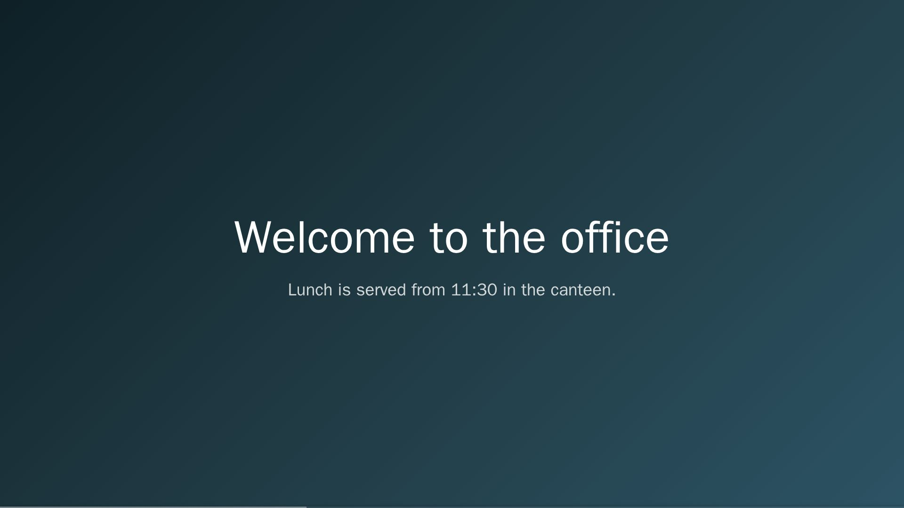
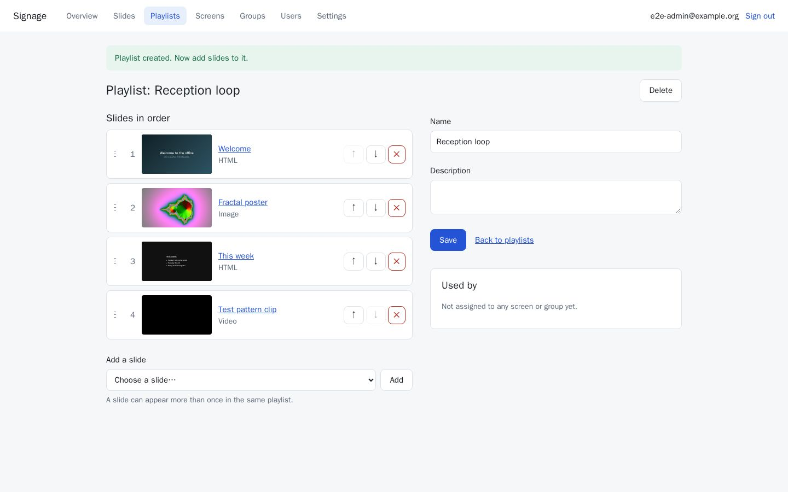
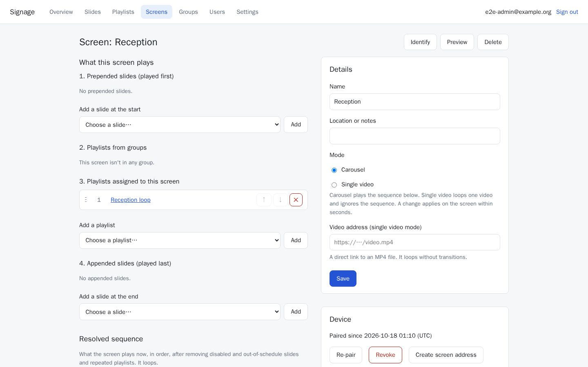
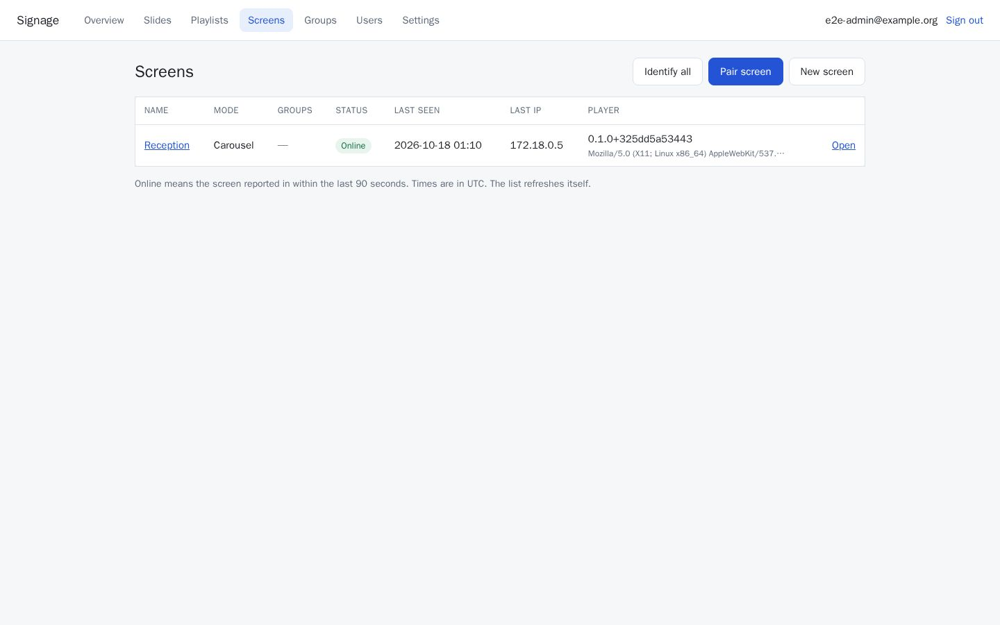
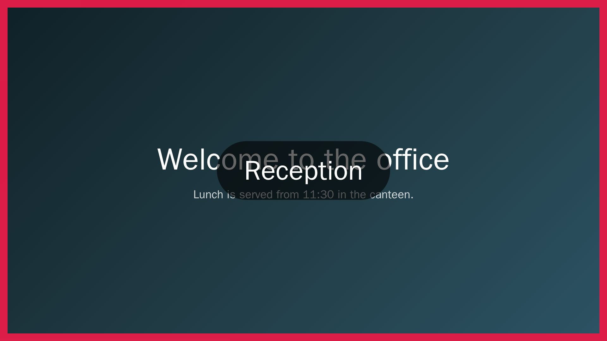
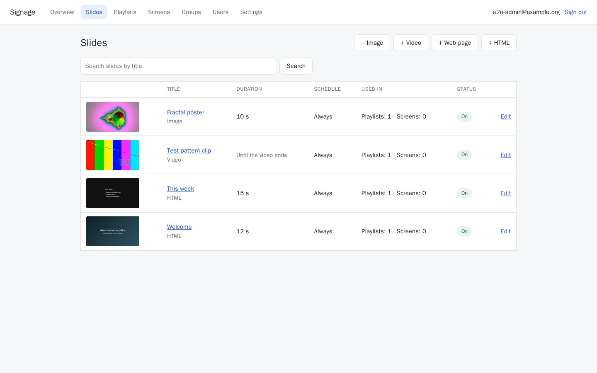
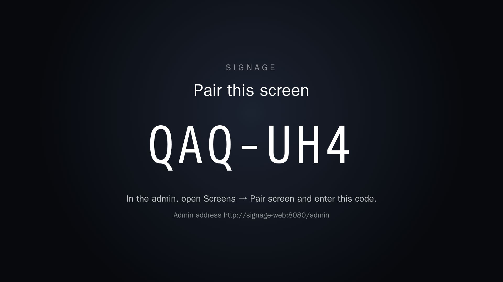

# Signage

A small, self-hostable digital signage system. Screens (TVs with a browser, or a mini-PC or Raspberry Pi in kiosk
mode) play a carousel of **slides** — images, videos, web pages and HTML — that you manage from one web admin. It runs
as one container plus PostgreSQL, on a laptop with Docker, a server in the office, or a cloud container service.



- **Slides, Playlists, Screens, Screen Groups.** Put slides in playlists; give playlists to screens directly or through
  groups; add slides before or after everything on one screen. The admin shows the exact sequence each screen plays.
- **A calm player.** The next slide slides in over the current one, a thin bar shows the time left, videos start only
  once they are in view, and nothing alarming ever appears on screen.
- **Live.** Changes reach the screens within seconds. Screens keep playing from their cache when the network or the
  server is down, and reload themselves after an update.
- **Simple setup.** Open `/screen` on a TV, type the code it shows into the admin, done. Or give a kiosk a
  pre-configured screen address.
- **Know your screens.** Online status, IP address and player version per screen; identify one screen (a red border
  and its name) or all of them; an optional name-and-IP line on every screen.
- **Single video mode** for screens that only loop one video.

| | |
|---|---|
|  |  |
|  |  |
|  |  |

## Quick start

You need Docker (with Compose v2) and Git.

```bash
git clone <this repository> signage
cd signage
docker compose up -d --build
```

The first build takes a few minutes. Then:

1. Open **http://localhost:8080** and create the first admin account.
2. The demo content is already there: a playlist **"Welcome (demo)"** and a screen **"Demo screen"** that plays it.
   (Two of its slides are photos loaded from nasa.gov, so they need internet. The others don't.)
3. On the TV, or in another browser window, open **http://&lt;your computer's address&gt;:8080/screen**. It shows a
   pairing code.
4. In the admin, go to **Screens → Pair screen**, type the code, choose **An existing screen → Demo screen**.
   The TV starts playing within a few seconds.

Stop it with `docker compose down` (add `-v` to delete the database too). For a clean start without the demo content,
set `SIGNAGE__SEEDDEMO: "false"` in `docker-compose.yml` before the first start, or delete the demo playlist, slides and
screen in the admin.

Change the database password before you run this anywhere that matters: the one in the file is a demo value. It
appears twice in `docker-compose.yml` (`POSTGRES_PASSWORD` and the app's connection string; better, override both in a
git-ignored `docker-compose.override.yml`). Do it **before the first start**: PostgreSQL sets the password when it
creates the volume, and changing the file later doesn't change it.

## Setting up a screen

Any modern browser that can show web pages full screen works: a smart TV's browser (2020 or newer), or a small
computer attached to the TV. Point it at `http://<server>:8080/screen`.

- **Pairing:** the screen shows a code; an admin enters it under **Screens → Pair screen**. The screen keeps its
  access in a cookie, so it stays paired across restarts. **Revoke** on the screen's page sends it back to pairing.
- **Pre-configured address:** on a screen's page, **Create screen address** gives a link that is shown only once
  (`/screen?token=…`). Use it as the kiosk's start page: the screen pairs itself on first start, also after the
  browser's data is wiped. Treat the link like a password.

### Kiosk browser flags

Videos play muted unless a slide has **Play audio** on, and browsers only allow sound without a click when they are
started with an autoplay policy. Without it, such videos still play, muted.

Chromium / Google Chrome:

```bash
chromium --kiosk --noerrdialogs --disable-session-crashed-bubble --disable-infobars \
  --autoplay-policy=no-user-gesture-required --check-for-update-interval=31536000 \
  "http://signage.example.internal:8080/screen?token=…"
```

Don't use incognito/guest mode: the screen keeps its access in a cookie.

Firefox: start with `--kiosk "<address>"` and set `media.autoplay.default` to `0` (allow audio and video) in
`about:config` or through an enterprise policy (`"Permissions": { "Autoplay": { "Default": "allow-audio-video" } }`).

Raspberry Pi: Raspberry Pi OS with Chromium in kiosk mode works with the flags above. A Pi 4 decodes H.264 in hardware;
keep videos at 1080p H.264 for the smoothest playback. (Ready-made Pi images are not part of this project.)

## Configuration

Everything is set with environment variables (the `SIGNAGE__` prefix maps to the `Signage` settings section).

| Variable | Default | What it does |
|---|---|---|
| `ConnectionStrings__Default` | — | PostgreSQL connection string (required), e.g. `Host=db;Database=signage;Username=signage;Password=…` |
| `SIGNAGE__MIGRATEONSTARTUP` | `true` | Apply database migrations at start-up (safe with several replicas: they take turns). With `false` the app refuses to start until the database is up to date: migrate yourself (see below) |
| `SIGNAGE__BOOTSTRAP__ADMINEMAIL`, `SIGNAGE__BOOTSTRAP__ADMINPASSWORD` | — | Create the first admin at start-up when there are no users (useful in the cloud). The password must be changed at first sign-in |
| `SIGNAGE__SEEDDEMO` | `false` (`true` in `docker-compose.yml`) | Create the demo playlist and "Demo screen" on an empty database |
| `SIGNAGE__FORWARDEDHEADERS__ENABLED` | `false` | Behind a reverse proxy or load balancer: take the client IP and scheme from `X-Forwarded-For`/`-Proto` |
| `SIGNAGE__FORWARDEDHEADERS__KNOWNNETWORKS` | — | Comma-separated CIDRs of those proxies, e.g. `10.0.0.0/8`. Empty trusts the nearest hop, which is only safe if the app can't be reached except through the proxy |
| `SIGNAGE__SCREENADDRESSEXCHANGESPERMINUTE` | `10` | Pre-configured screen addresses accepted per client IP and minute |
| `ASPNETCORE_HTTP_PORTS` | `8080` | The port the container listens on |

Settings in the admin (**Settings**): default slide duration, the info overlay (name and IP on every screen) and the
system time zone used for schedules and times.

`docker-compose.yml` also publishes PostgreSQL on **127.0.0.1:55432** (loopback only), so you can run the app from source
against it. Change the port with `SIGNAGE_DB_PORT=…`, or remove the `ports:` section of the `db` service if you don't
need it.

To migrate by hand, generate an idempotent SQL script from a checkout of the **same version** and apply it:

```bash
dotnet tool restore
dotnet ef migrations script --idempotent -p src/Signage.Web -o migrate.sql
psql "host=… dbname=signage user=signage" -f migrate.sql
```

Health endpoints: `/healthz` (the process is up) and `/readyz` (the database is reachable). The image has no shell, so
probe them from outside (the load balancer, the orchestrator).

## Security

**Signage is meant for a trusted network behind your firewall.** Don't expose it to the internet.

- Users have local accounts (admin or editor) with passwords hashed by ASP.NET Core's password hasher (PBKDF2); repeated wrong passwords
  lock the account for a while. Screens authenticate with a long random token kept in an HttpOnly cookie and stored
  hashed on the server.
- HTML slides may contain scripts. They run in a sandboxed frame without access to the admin or the player, but only
  give editor access to people you trust.
- Over plain HTTP, the admin's sign-in cookie can't be marked `Secure`, and passwords cross the network readable. If
  the network isn't fully trusted, put a reverse proxy with HTTPS in front (Caddy, nginx, Traefik, a cloud load
  balancer) and set `SIGNAGE__FORWARDEDHEADERS__ENABLED=true` so the app knows the request was HTTPS.
- Screens need to reach the server on its port (8080 by default). Nothing needs to reach the screens. Slides that show
  images, videos or web pages from elsewhere need the screens to reach those hosts.

## Updating

Pull the new version and rebuild (`git pull && docker compose up -d --build`), or deploy the new image. Migrations run
at start-up, and every screen reloads itself shortly after it sees the new version (also when only the player changed).
Data stays in the PostgreSQL volume.

## Deploying

- [Azure Container Apps + Azure Database for PostgreSQL](docs/deploy/azure-container-apps.md)
- [AWS: ECS Fargate (or App Runner) + Amazon RDS for PostgreSQL](docs/deploy/aws.md)

The image is multi-arch (amd64 and arm64). Build and push it yourself with Docker Buildx:

```bash
docker buildx build --platform linux/amd64,linux/arm64 -t registry.example.com/signage:0.1.0 --push .
```

If Docker says multi-platform builds aren't supported, create a builder first: `docker buildx create --use`.

The container runs as a non-root user and listens on port 8080. Several replicas can run side by side: they share the
database, and live updates reach every screen whichever replica it is connected to.

## Developing

See [CONTRIBUTING.md](CONTRIBUTING.md). In short: .NET 10 SDK and Docker; `dotnet build`, `dotnet test`,
`scripts/test-e2e.sh`. The design lives in [docs/](docs/): the project brief, the architecture, the player spec and
the decision records.

## Licence

MIT, see [LICENSE](LICENSE). Signage is provided "as is", without warranty of any kind: you run it at your own risk.
